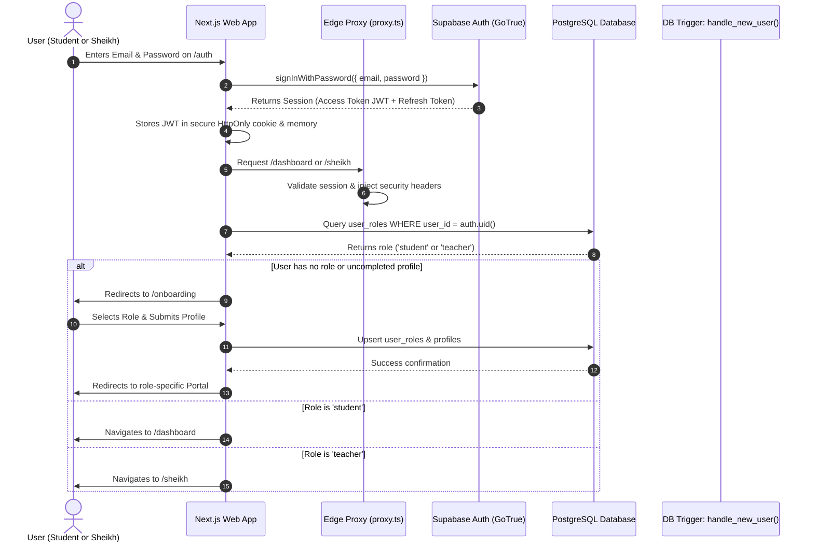
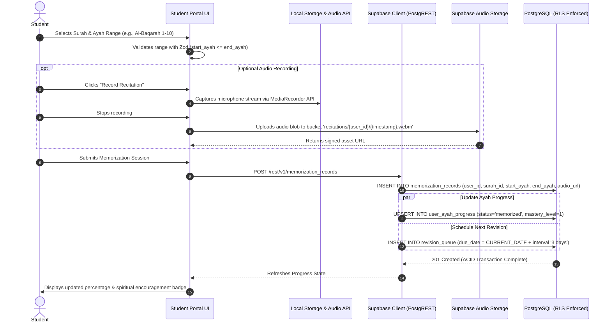
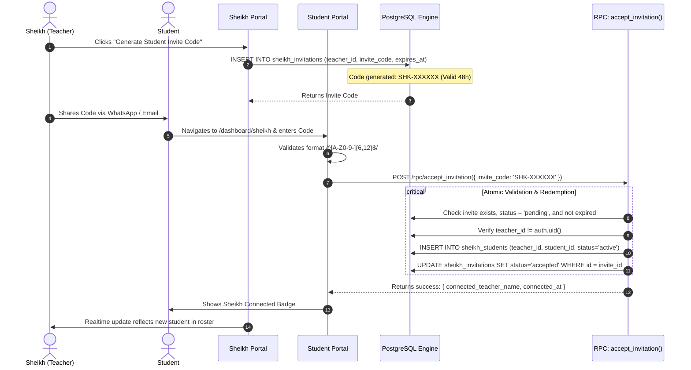
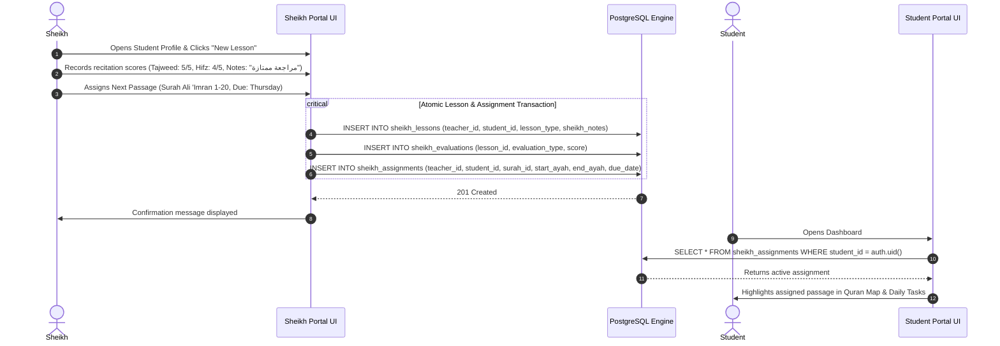

# DATA FLOW & LIFECYCLE ARCHITECTURE — QURAN TRACKER (رحلتي مع القرآن)

## 1. System Data Flow Overview

This document outlines the end-to-end data lifecycles across client applications, Next.js Edge Proxy, Supabase Auth (GoTrue), PostgreSQL database engine, and encrypted media storage. Every critical user interaction adheres to zero-trust principles, cryptographic validation, and atomic database transactions.

---

## 2. Authentication, Role Injection & Onboarding Lifecycle

---

## 3. Student Memorization & Revision Tracking Lifecycle

---

## 4. Single-Use Invitation & Sheikh-Student Connection Lifecycle

To ensure total privacy and prevent unauthorized student surveillance, connections are established exclusively via cryptographically generated, single-use invitation codes.

---

## 5. Sheikh Lesson Evaluation & Passage Assignment Flow

---

## 6. Privacy Boundaries & Data Segregation Guarantees

The application enforces cryptographic and relational privacy boundaries:

1. **Student Personal Privacy**:
   - A Sheikh **CANNOT** view a student's profile, logs, or memorization progress unless an active record exists in `sheikh_students` with `status = 'active'`.
   - If a student terminates or pauses the connection, all Sheikh read access is revoked instantaneously at the database level.
2. **Teacher Isolation**:
   - Sheikhs cannot view students assigned to other Sheikhs.
   - Invitation codes are single-use; once claimed, replay attacks fail with an explicit `INVITATION_ALREADY_USED` exception.
3. **No Unauthenticated Snooping**:
   - All REST queries through PostgREST require a valid Bearer JWT. Anonymous users receive `401 Unauthorized` for all non-public tables.
